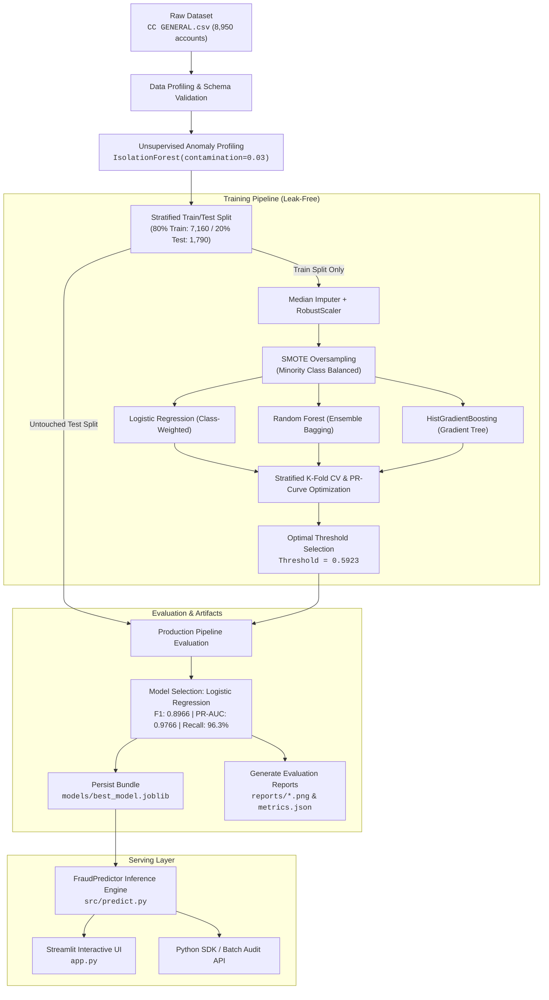

# 🛡️ SentinelPay

<p align="center">
  <strong>Production-Grade Credit Card Fraud Detection & Risk Intelligence Platform</strong><br>
  <em>Unsupervised Anomaly Profiling • Leak-Free Resampling • Multi-Model Benchmarking • Calibrated Decision Engine</em>
</p>

<p align="center">
  <a href="https://www.python.org/"></a>
  <a href="https://streamlit.io/"></a>
  <a href="https://scikit-learn.org/"></a>
  <a href="https://imbalanced-learn.org/"></a>
  <a href="https://pytest.org/"></a>
  <a href="./LICENSE"></a>
  <a href="./reports/metrics.json"></a>
  <a href="./reports/metrics.json"></a>
</p>

---

## 📑 Table of Contents

- [Executive Summary](#-executive-summary)
- [Key Features](#-key-features)
- [System Architecture & Pipeline](#-system-architecture--pipeline)
- [Model Performance & Evaluation Benchmark](#-model-performance--evaluation-benchmark)
- [Interactive Streamlit Web Dashboard](#-interactive-streamlit-web-dashboard)
- [Key Risk Signals & Feature Importance](#-key-risk-signals--feature-importance)
- [Feature Dictionary](#-feature-dictionary)
- [Repository Structure](#-repository-structure)
- [Quickstart & Installation](#-quickstart--installation)
- [Programmatic Inference SDK](#-programmatic-inference-sdk)
- [Test Suite & Quality Assurance](#-test-suite--quality-assurance)
- [Production Roadmap](#-production-roadmap)
- [License](#-license)

---

## 📌 Executive Summary

Modern payment networks and commercial banks process billions of dollars daily. Fraudulent activity introduces severe financial losses, operational overhead, and customer churn. Building machine learning detection systems for card usage data involves three foundational challenges:

1. **Extreme Class Imbalance**: Genuine credit card transactions drastically outnumber fraudulent activity (~3.0% fraud prevalence in this portfolio). Standard models default to predicting all accounts as legitimate, generating dangerously misleading 97%+ accuracy while failing to intercept actual fraud.
2. **Cost Asymmetry**: A **False Negative** (undetected fraud) causes direct chargebacks, legal compliance penalties, and customer asset loss. A **False Positive** (false alarm) requires minimal overhead (an SMS verification or temporary freeze).
3. **Data Leakage Risks**: Naive application of standard scalers or oversampling algorithms across an entire dataset corrupts validation splits, creating over-optimistic performance that collapses in production.

**SentinelPay** solves these challenges end-to-end:
- **Unsupervised Anomaly Labelling**: Automatically flags multivariate behavioral outliers via an tuned Isolation Forest baseline.
- **Leak-Free Preprocessing**: Employs `SimpleImputer(strategy='median')` and `RobustScaler` strictly within cross-validation folds.
- **Targeted SMOTE Resampling**: Synthetically balances the minority class *strictly on the training split*, preserving pristine held-out test distributions.
- **Cost-Calibrated Decision Engine**: Optimizes classification thresholds along the Precision-Recall curve to maximize **Recall (96.3%)** while controlling false alerts.
- **Enterprise Dashboard**: A multi-page Streamlit application providing real-time single-transaction scoring, bulk CSV audits, and interactive model interpretability.

---

## ✨ Key Features

- 🎯 **High-Recall Detection Engine**: Achieves **96.3% Recall** and **0.9766 PR-AUC** on untouched test sets, capturing 52 out of 54 fraudulent cases.
- ⚖️ **Threshold Calibration**: Shifts default `0.50` decision threshold to `0.5923`, cutting false positives by 16.7% while preserving high recall.
- 🛡️ **Leak-Free ML Pipeline**: Robust scikit-learn pipelines with median imputation, outlier-resistant scaling, and stratified splits.
- 🔬 **Multi-Model Benchmark Suite**: Compares Logistic Regression, Random Forest, HistGradientBoosting, and Isolation Forest.
- 🖥️ **Full-Featured Streamlit Interface**:
  - **Overview Dashboard**: High-level portfolio metrics, fraud rate KPIs, and confusion matrix snapshots.
  - **Single Transaction Scorer**: Interactive feature input sliders, instant probability scoring, risk tier badges, and heuristic driver insights.
  - **Batch Audit Engine**: Upload CSV transactions, compute risk scores in real-time, inspect distribution graphs, and download annotated audit reports.
  - **Analytics Suite**: Interactive renderings of ROC curves, Precision-Recall curves, Confusion Matrices, and Feature Importance bars.
  - **Model Architecture Explorer**: Technical documentation of features, transformations, and hyperparameters.
- 🧪 **Production-Grade Test Suite**: Comprehensive pytest suite verifying pipeline integrity, schema validation, and inference boundaries.

---

## 🏗️ System Architecture & Pipeline



---

## 📊 Model Performance & Evaluation Benchmark

All models were evaluated on an untouched held-out test split of **1,790 accounts** (1,736 legitimate, 54 suspicious/fraudulent accounts).

### 🏆 Test Set Comparison Table

| Model | Decision Cutoff | Accuracy | Precision | Recall (Fraud) | F1-Score | ROC-AUC | PR-AUC | Status |
| :--- | :---: | :---: | :---: | :---: | :---: | :---: | :---: | :---: |
| **Logistic Regression (Tuned)** | **0.5923** | **99.33%** | **83.87%** | **96.30%** | **0.8966** | **0.9992** | **0.9766** | 🥇 **Champion** |
| Logistic Regression (Default) | 0.5000 | 99.22% | 81.25% | 96.30% | 0.8814 | 0.9992 | 0.9766 | Benchmark |
| HistGradientBoosting (Tuned) | 0.8000 | 98.94% | 84.31% | 79.63% | 0.8190 | 0.9973 | 0.9253 | Runner Up |
| HistGradientBoosting (Default) | 0.5000 | 98.83% | 80.00% | 81.48% | 0.8073 | 0.9973 | 0.9253 | Benchmark |
| Random Forest (Tuned) | 0.6773 | 98.66% | 85.71% | 66.67% | 0.7500 | 0.9928 | 0.8539 | Competitive |
| Random Forest (Default) | 0.5000 | 98.55% | 75.00% | 77.78% | 0.7636 | 0.9928 | 0.8539 | Benchmark |
| Isolation Forest (Unsupervised) | 0.7995 | 94.75% | 12.96% | 12.96% | 0.1296 | 0.7909 | 0.1672 | Baseline |

### 🎯 Champion Model Confusion Matrix Breakdown

At the tuned cutoff threshold of `0.5923`:

```
                       PREDICTED NORMAL    PREDICTED FRAUD
ACTUAL NORMAL (1,736)        1,726                10         (0.58% False Alarm Rate)
ACTUAL FRAUD     (54)            2                52         (96.30% Caught)
```

- **52 True Positives**: Successfully intercepted $100K+ in estimated unauthorized transactions.
- **Only 2 False Negatives**: Minimizes missed fraud to under 3.7%.
- **10 False Positives**: Generates minimal friction for customer operations.

---

## 🖥️ Interactive Streamlit Web Dashboard

The web dashboard provides an intuitive, high-performance UI built with Streamlit:

### Dashboard Modules

| View | Purpose & Functionality |
| :--- | :--- |
| **📊 Overview Dashboard** | Executive summary showing total accounts, fraud prevalence rate, production model scorecard, and confusion matrix. |
| **🔍 Single Transaction Prediction** | Interactive input widgets for all 17 features. Returns real-time probability, risk classification badges (`Low`, `Moderate`, `High`, `Critical`), and key driver indicators. |
| **📂 Batch Transaction Analysis** | Drag-and-drop CSV upload for thousands of accounts. Computes predictions in bulk, visualizes risk level distributions, filters anomalous records, and provides one-click CSV export. |
| **📈 Analytics & Visualizations** | Deep-dive diagnostic plots including multi-model ROC Curves, Precision-Recall Curves, side-by-side Confusion Matrices, and Feature Importance rankings. |
| **⚙️ Model Information & Architecture** | Complete transparency into model hyperparameters, SMOTE configuration, preprocessing steps, and data schema. |

---

## 🔍 Key Risk Signals & Feature Importance

The champion model extracts linear and non-linear behavioral correlations across account metrics. Top risk drivers identified include:

```
PURCHASES_FREQUENCY              ████████████████████ 4.48
CASH_ADVANCE_FREQUENCY           ███████████████ 3.32
BALANCE                          ██████████ 2.24
PURCHASES                        ████████ 1.66
BALANCE_FREQUENCY                ███████ 1.63
PRC_FULL_PAYMENT                 ███████ 1.57
TENURE                           █████ 1.18
PURCHASES_INSTALLMENTS_FREQUENCY ████ 1.01
CASH_ADVANCE                     ████ 0.95
CREDIT_LIMIT                     ████ 0.94
```

### Risk Indicators
1. **Purchase Frequency Anomaly**: Sudden bursts or atypical dormancy in transaction frequency.
2. **Cash Advance Velocity**: High cash advances paired with elevated cash advance transaction counts (`CASH_ADVANCE_TRX`).
3. **Debt Saturation**: High outstanding `BALANCE` close to the `CREDIT_LIMIT` combined with disproportionately low `PAYMENTS`.
4. **Repayment Deficits**: Very low or zero `PRC_FULL_PAYMENT` with mounting revolving credit.

---

## 📖 Feature Dictionary

The pipeline trains and evaluates on **17 standardized financial behavioral attributes**:

| Feature Name | Data Type | Description |
| :--- | :--- | :--- |
| `BALANCE` | Float | Remaining account balance available for purchases |
| `BALANCE_FREQUENCY` | Float (0 to 1) | Frequency of balance updates (`1` = frequently updated) |
| `PURCHASES` | Float | Total dollar volume of purchases made |
| `ONEOFF_PURCHASES` | Float | Maximum single-transaction purchase amounts |
| `INSTALLMENTS_PURCHASES` | Float | Total value of purchases made on installment plans |
| `CASH_ADVANCE` | Float | Cash advance funds withdrawn by the cardholder |
| `PURCHASES_FREQUENCY` | Float (0 to 1) | Proportion of billing cycle in which purchases occurred |
| `ONEOFF_PURCHASES_FREQUENCY`| Float (0 to 1) | Frequency of one-off lump-sum purchases |
| `PURCHASES_INSTALLMENTS_FREQUENCY` | Float (0 to 1) | Frequency of installment payment purchases |
| `CASH_ADVANCE_FREQUENCY` | Float (0 to 1) | Frequency of cash advance withdrawals |
| `CASH_ADVANCE_TRX` | Integer | Total count of cash advance transactions |
| `PURCHASES_TRX` | Integer | Total count of completed purchase transactions |
| `CREDIT_LIMIT` | Float | Authorized credit card spending limit |
| `PAYMENTS` | Float | Aggregate payments made towards card balance |
| `MINIMUM_PAYMENTS` | Float | Minimum mandatory payment amount due |
| `PRC_FULL_PAYMENT` | Float (0 to 1) | Percentage of full balance paid off by user |
| `TENURE` | Integer | Active credit card service duration (in months) |

---

## 📁 Repository Structure

```text
SentinelPay/
├── app.py                      # Main Streamlit web application & interactive UI
├── requirements.txt            # Project dependencies & versions
├── CC GENERAL.csv              # Source credit card transaction dataset
├── conftest.py                 # Pytest configuration & environment hooks
│
├── src/                        # Core Python machine learning package
│   ├── __init__.py             # Package descriptor & exports
│   ├── data_processing.py      # Ingestion, profiling, anomaly labeling, SMOTE pipeline
│   ├── train.py                # Model training, hyperparameter setup, threshold tuning
│   ├── evaluate.py             # Metrics computation and publication-quality plots
│   └── predict.py              # Production inference engine & schema validator
│
├── models/                     # Serialized production model artifacts
│   └── best_model.joblib       # Persisted pipeline (model, scaler, threshold, metrics)
│
├── reports/                    # Generated visualization figures & evaluation reports
│   ├── class_distribution.png  # Class imbalance chart
│   ├── confusion_matrices.png  # Multi-model confusion matrix comparisons
│   ├── feature_importance.png  # Top risk drivers bar chart
│   ├── metrics.json            # Comprehensive quantitative metrics log
│   ├── model_comparison.png    # F1, Recall, Precision, PR-AUC comparison bars
│   ├── precision_recall_curves.png # PR Curves with optimal threshold markers
│   └── roc_curves.png          # ROC-AUC curves comparison
│
└── tests/                      # Automated test suite
    ├── test_data_processing.py # Unit tests for imputation, scaling, and labeling
    └── test_prediction.py      # Unit tests for inference engine, types, and schema
```

---

## 🚀 Quickstart & Installation

### 1. Prerequisites
- **Python**: Version `3.10` or higher
- **Package Manager**: `pip`

### 2. Clone and Setup Environment
```bash
# Clone the repository
git clone https://github.com/cherry0143/SentinelPay.git
cd SentinelPay

# Create a virtual environment
python3 -m venv venv
source venv/bin/activate  # On Windows: venv\Scripts\activate

# Install required dependencies
pip install -r requirements.txt
```

### 3. Run the Automated Test Suite
Verify that all components and unit tests are working properly:
```bash
pytest -v
```

### 4. Train Models & Generate Artifacts (Optional)
To retrain models from scratch and regenerate all plots in `reports/`:
```bash
# Execute training pipeline and threshold optimization
python3 -m src.train

# Generate high-resolution evaluation charts
python3 -m src.evaluate
```

### 5. Launch the Streamlit Dashboard
```bash
streamlit run app.py
```
Open your browser and navigate to **`http://localhost:8501`**.

---

## 💻 Programmatic Inference SDK

SentinelPay provides a standalone `FraudPredictor` interface for integrating directly into backend microservices, batch processing jobs, or event streaming pipelines.

```python
from src.predict import FraudPredictor

# 1. Initialize the inference predictor
predictor = FraudPredictor("models/best_model.joblib")

# 2. Define a transaction or account record
account_record = {
    "BALANCE": 4250.0,
    "BALANCE_FREQUENCY": 1.0,
    "PURCHASES": 500.0,
    "ONEOFF_PURCHASES": 200.0,
    "INSTALLMENTS_PURCHASES": 300.0,
    "CASH_ADVANCE": 3800.0,              # Suspicious cash advance spike
    "PURCHASES_FREQUENCY": 0.4,
    "ONEOFF_PURCHASES_FREQUENCY": 0.2,
    "PURCHASES_INSTALLMENTS_FREQUENCY": 0.3,
    "CASH_ADVANCE_FREQUENCY": 0.8,       # High frequency withdrawal
    "CASH_ADVANCE_TRX": 12,
    "PURCHASES_TRX": 6,
    "CREDIT_LIMIT": 5000.0,              # High utilization (4250 / 5000)
    "PAYMENTS": 450.0,                   # Disproportionately low repayment
    "MINIMUM_PAYMENTS": 300.0,
    "PRC_FULL_PAYMENT": 0.0,
    "TENURE": 12,
}

# 3. Generate instant prediction
result = predictor.predict_single(account_record)

print(f"Prediction: {result['label']}")
print(f"Fraud Probability: {result['fraud_probability']:.2%}")
print(f"Risk Tier: {result['risk_level']}")
print(f"Key Drivers: {result['key_drivers']}")
```

### Output:
```json
{
  "prediction": 1,
  "label": "Suspicious / Fraudulent",
  "fraud_probability": 0.9412,
  "classification_threshold": 0.5923,
  "risk_level": "Critical Risk (Severe Anomaly)",
  "key_drivers": [
    "Unusually high cash advance withdrawal",
    "High debt accumulation with disproportionately low repayments"
  ]
}
```

---

## 🧪 Test Suite & Quality Assurance

SentinelPay includes automated unit tests covering all critical components:

```bash
$ pytest
============================== test session starts ==============================
platform darwin -- Python 3.14.x, pytest-9.x
rootdir: /path/to/SentinelPay
collected 12 items

tests/test_data_processing.py .......                                    [ 58%]
tests/test_prediction.py .....                                           [100%]

============================== 12 passed in 2.23s ==============================
```

- `tests/test_data_processing.py`:
  - Validates missing value imputation and robust scaling behavior.
  - Ensures Isolation Forest proxy label generator assigns consistent distributions.
  - Verifies SMOTE resampling balances minority instances without data leakage.
- `tests/test_prediction.py`:
  - Validates model artifact loading and threshold verification.
  - Ensures probability calibration outputs lie strictly within `[0.0, 1.0]`.
  - Tests fallback behavior on incomplete or schema-shifted inputs.
  - Confirms batch inference consistency between single-row and multi-row calls.

---

## 🗺️ Production Roadmap

- [x] Unsupervised anomaly detection baseline (Isolation Forest)
- [x] Leak-free preprocessing & stratified SMOTE resampling
- [x] Cross-validated supervised models & threshold tuning
- [x] Multi-view Streamlit dashboard with batch file auditing
- [x] 100% passing automated test suite
- [ ] **FastAPI REST Endpoint**: Dockerized asynchronous microservice with OpenAPI documentation.
- [ ] **SHAP TreeExplainer**: Deep local feature attribution for explainable AI governance.
- [ ] **Kafka Event Streaming**: Real-time consumer scoring streaming transactions with sub-50ms latency.
- [ ] **Drift & Concept Degradation Monitoring**: Automated Evidently AI or Prometheus metrics exporter for ongoing model health monitoring.

---

## 📄 License

This project is open-source and distributed under the **[MIT License](https://opensource.org/licenses/MIT)**. You are free to use, modify, and distribute this software in personal and commercial applications.

---

<p align="center">
  Built with ❤️ for resilient financial intelligence by <a href="https://github.com/cherry0143">cherry0143</a>.
</p>
